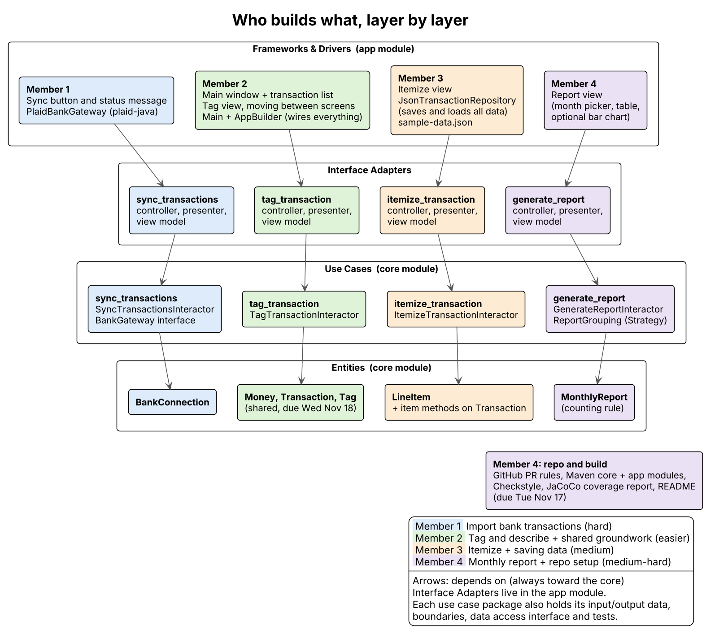
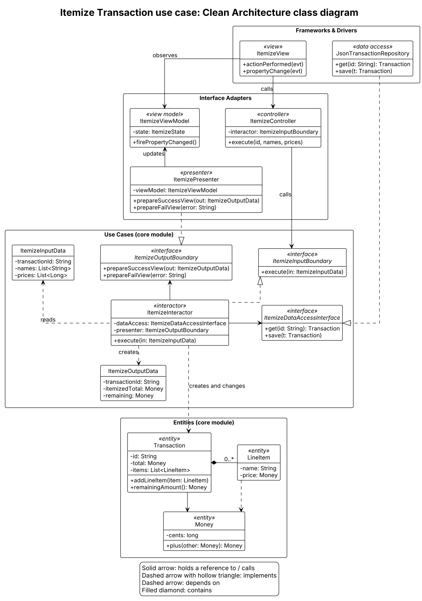
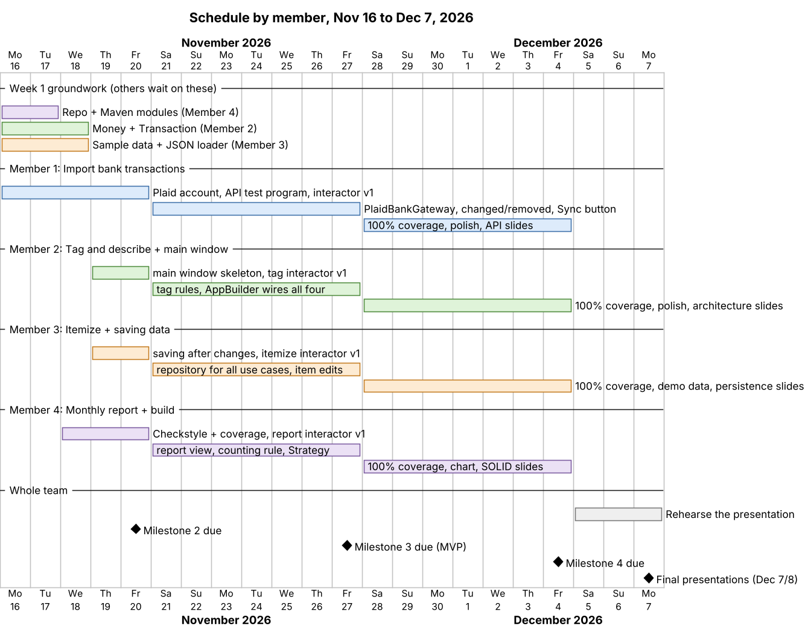

# Bookkeeping App

A personal bookkeeping desktop app for CSC207 (Fall 2026, University of Toronto). Java, Swing, Clean Architecture, and the Plaid API.

> _Working title. Replace "Bookkeeping App" with your team's app name, and fill in every `TODO`._

## Contents

1. [About the app](#about-the-app)
2. [Team](#team)
3. [User stories](#user-stories)
4. [Use cases (MVP)](#use-cases-mvp)
5. [Entities](#entities)
6. [Architecture](#architecture)
7. [External API: Plaid](#external-api-plaid)
8. [Data persistence](#data-persistence)
9. [Getting started](#getting-started)
10. [Project structure](#project-structure)
11. [How we work](#how-we-work)
12. [Timeline](#timeline)
13. [Decisions log](#decisions-log)

---

## About the app

Our app is a personal bookkeeping tool. It imports the purchases you make with your bank cards automatically, so your spending history builds itself with very little typing.

For any purchase you can go one level deeper and record what you actually bought. For example, a $120 trip to Superstore can be broken down into items such as $11 for two cartons of milk. You can add a description and several tags (such as "Groceries" or "Weekly run") to any purchase, and generate a monthly report of how much you spent under each tag.

**Stretch goals:** record cash purchases by hand, search your history, set a monthly budget per tag, and photograph a receipt to fill in the items automatically.

---

## Team

| Member | Name | GitHub | Leads use case | Also owns |
| --- | --- | --- | --- | --- |
| Member 1 | TODO | TODO | Import bank transactions | Plaid account and Sandbox keys |
| Member 2 | TODO | TODO | Tag and describe a transaction | `Money` and `Transaction` entities, main window, moving between screens, app wiring |
| Member 3 | TODO | TODO | Itemize a transaction | Saving and loading the JSON file, sample data |
| Member 4 | TODO | TODO | Generate monthly report | Repo and build setup, Checkstyle, test coverage report |

**Meetings:** TODO (e.g. weekly lab, plus a check-in on ___).
**Communication:** TODO (e.g. Discord or a group chat).

---

## User stories

Each member leads one user story. Each story becomes one use case in the program.

| # | User story | Lead |
| --- | --- | --- |
| 1 | As a user, I want my bank card purchases imported automatically so that I don't have to type in every transaction. | Member 1 |
| 2 | As a user, I want to add a description and tags to a purchase so that I can group and remember my spending. | Member 2 |
| 3 | As a user, I want to break a purchase into the items I bought so that I know what my money actually went to. | Member 3 |
| 4 | As a user, I want a monthly report of my spending by tag so that I can see where my money goes. | Member 4 |

---

## Use cases (MVP)

Each use case is written from the user's point of view. Each one says what the program does, not how it does it.

### Use case 1: Import bank transactions (lead: Member 1)

**Primary actor:** User

**Preconditions:** The user has a bank account the app can connect to. During the course, this is a Plaid test bank.

**Trigger:** The user asks the app to sync with their bank.

**Success outcome:** Every settled transaction since the last sync is in the user's history, with no duplicates, and the user sees what changed.

**Main success scenario:**

1. The user asks to sync.
2. If no bank is connected yet, the system connects the user's bank.
3. The system retrieves every settled transaction that was added, changed or removed since the last sync.
4. The system adds the new transactions, giving each a starting tag based on the bank's spending category.
5. The system updates changed transactions, keeping the user's tags, description and items, and deletes transactions the bank removed.
6. The system remembers where this sync finished.
7. The system shows how many transactions were added, changed and removed.

**Extensions:**

- **3a.** The bank can't be reached.
  1. The system explains the problem.
  2. Nothing changes, and the next sync starts from the same point.
- **3b.** There is nothing new. The system says there are no new transactions.
- **5a.** A changed transaction's items now add up to more than its new total. The system marks the transaction so the user can fix its items.

### Use case 2: Tag and describe a transaction (lead: Member 2)

**Primary actor:** User

**Preconditions:** The user is viewing their transaction history, which has at least one transaction.

**Trigger:** The user chooses a transaction and asks to edit its tags and description.

**Success outcome:** The transaction's tags and description are saved, and the history shows them.

**Main success scenario:**

1. The system shows the transaction's current tags and description.
2. The user adds or removes tags. As they type, the system suggests matching tags they have used before.
3. The user edits the description.
4. The user asks to save.
5. The system checks the tags and the description.
6. The system saves them and shows the updated transaction in the history.

**Extensions:**

- **2a.** The user adds a tag that matches an existing tag apart from capital letters or extra spaces. The system uses the existing tag.
- **5a.** A tag is empty, or the description is longer than 200 characters.
  1. The system explains the problem.
  2. Nothing is saved, and the user can correct it.

### Use case 3: Itemize a transaction (lead: Member 3)

**Primary actor:** User

**Preconditions:** The user has at least one recorded transaction and is viewing it.

**Trigger:** The user asks to break the transaction into items.

**Success outcome:** The items are saved with the transaction, and the user sees each item and the amount not yet itemized.

**Main success scenario:**

1. The user enters one or more items, each with a name, a price and, optionally, one tag.
2. The system checks that the items do not add up to more than the transaction total.
3. The system saves the items with the transaction.
4. The system shows the items and the remaining amount not yet itemized.

**Extensions:**

- **1a.** The user edits or removes an existing item. The use case continues from step 2.
- **2a.** The items add up to more than the transaction total.
  1. The system explains the problem and by how much.
  2. Nothing is saved, and the user can correct the items.
- **3a.** The system cannot save the items. The system says the items were not saved and that the user may try again.

### Use case 4: Generate monthly report (lead: Member 4)

**Primary actor:** User

**Preconditions:** None.

**Trigger:** The user asks for a spending report for a particular month.

**Success outcome:** The user sees how much they spent under each tag that month, and the month's total spending.

**Main success scenario:**

1. The user chooses a month.
2. The system gathers that month's spending. Money coming in, such as refunds and deposits, is left out.
3. The system totals the spending for each tag. A purchase counts in full under every one of its tags, and an item also counts under its own tag. Within one tag, a dollar never counts twice.
4. The system shows the total per tag, the untagged amount and the month's total spending, with a note that tag totals can add up to more than the total.

**Extensions:**

- **2a.** There is no spending that month. The system says so.
- **4a.** The user asks to see totals by store instead of by tag. The system shows them the same way.

**Example:** a $120.00 Superstore trip tagged _Shopping_ and _Weekly run_, with an $11.00 milk item tagged _Groceries_, gives:

| Tag | Total |
| --- | --- |
| Shopping | $120.00 |
| Weekly run | $120.00 |
| Groceries | $11.00 |
| **Total spending** | **$120.00** |

---

## Entities

All entities live in the `entity` package and are plain Java.

| Entity | What it holds | Rule it enforces | Owner |
| --- | --- | --- | --- |
| `Money` | An amount in cents (`long`) and a currency (CAD) | Never stored as a `double`; only adds amounts in the same currency | Member 2 |
| `Transaction` | Id, source (bank or manual), Plaid transaction id, date, store, total, description, one or more tags, line items | A manual total must be positive; the date can't be in the future | Member 2 (line-item methods: Member 3) |
| `Tag` | A normalized name | "Groceries" and "groceries " are the same tag | Member 2 |
| `LineItem` | Name, quantity, price, at most one tag | All items together can't exceed the transaction total | Member 3 |
| `MonthlyReport` | Month, total per tag, untagged amount, total spending | The counting rule in use case 4 | Member 4 |
| `BankConnection` | Bank name, Plaid access token, sync position (cursor) | The sync position only moves forward after a complete sync | Member 1 |

---

## Architecture

We follow **Clean Architecture**. Source-code dependencies only point inward: Frameworks & Drivers → Interface Adapters → Use Cases → Entities.

The code is one Maven project, laid out like the course's `ca-login` example. Each layer is a set of top-level packages:

| Layer | Packages | What's in them |
| --- | --- | --- |
| Entities | `entity` | `Money`, `Transaction`, `Tag`, `LineItem`, `MonthlyReport`, `BankConnection` |
| Use Cases | `use_case` | One sub-package per use case: input and output data, boundaries, data access interface, interactor |
| Interface Adapters | `interface_adapter` | One sub-package per use case: controller, presenter, view model, state |
| Frameworks & Drivers | `view`, `data_access`, `app` | Swing views, the JSON file repository, the Plaid gateway, and `Main` + `AppBuilder` |

`entity` and `use_case` are plain Java: no Swing, JSON, file or Plaid imports, and no imports from the outer packages. Reviewers check this on every pull request.

### Who builds what

Each colour is one member. Every arrow points inward, toward the entities.



### How every use case is built

Every use case uses the same set of classes. The diagram shows them for Itemize; the other three use cases follow the same pattern with their own names.



The flow for one user action:

1. The **View** calls the **Controller**.
2. The **Controller** packs the input into **Input Data** and calls the **Input Boundary**, which the **Interactor** implements.
3. The **Interactor** loads and saves data through its **Data Access Interface**, which the JSON repository implements.
4. The **Interactor** uses the **Entities** to apply the rules.
5. The **Interactor** sends **Output Data** through the **Output Boundary**, which the **Presenter** implements.
6. The **Presenter** updates the **View Model**, and the **View** redraws itself (Observer pattern).

### Design patterns

| Pattern | Where |
| --- | --- |
| Observer | Views listen to their view models (`PropertyChangeSupport`) |
| Adapter | `PlaidBankGateway` adapts Plaid's API to our `BankGateway` interface |
| Strategy | `ReportGrouping`: report by tag or by store without changing the interactor |

---

## External API: Plaid

We use [Plaid](https://plaid.com/docs/) through the official [`plaid-java`](https://github.com/plaid/plaid-java) library to import bank transactions. During the course, everything runs in Plaid's **Sandbox**, which serves test banks and test transactions.

| Step | Plaid endpoint | What it does |
| --- | --- | --- |
| Connect a test bank | `/sandbox/public_token/create` | Creates a test bank connection without Plaid's web sign-in screen (Sandbox only) |
| Get an access token | `/item/public_token/exchange` | Exchanges the public token for an access token we store |
| Sync | `/transactions/sync` | Returns transactions added, changed and removed since our saved cursor |

What we take from each transaction: id, date, amount, store name, currency, pending flag, and the main spending category. Notes:

- Plaid amounts are **positive when money leaves the account**. `PlaidBankGateway` converts them in one place.
- **Pending transactions are skipped.** We only import settled ones.
- Plaid's category codes (e.g. `FOOD_AND_DRINK`) are mapped to readable starting tags (e.g. "Food and drink"). Any code missing from the map is auto-formatted.
- Our Sandbox test user has transactions in **CAD**. Plaid's test data defaults to US dollars, so we use a custom Sandbox user.

**API test output:** TODO. Paste the output of the Plaid test program here (Milestone 2).

---

## Data persistence

All data is saved to one JSON file, `~/.bookkeeping/data.json` (TODO: confirm the folder name). It holds transactions, tags, line items and the bank connection with its sync cursor.

- The app loads the file at startup and saves after every change.
- If the file is missing or damaged, the app starts empty and tells the user. It never crashes.
- `sample-data.json` (about 20 CAD transactions over two months) can be loaded for development and demos.

---

## Getting started

**You need:** Java 17 or newer, Maven, and the team's Plaid Sandbox keys (ask Member 1; never commit them).

1. Clone the repo and open it in IntelliJ as a Maven project.
2. Set your Plaid keys as environment variables:
   ```bash
   export PLAID_CLIENT_ID=your-client-id
   export PLAID_SECRET=your-sandbox-secret
   ```
   On Windows, set them under System Properties → Environment Variables, or in IntelliJ's run configuration.
3. Build and run all checks:
   ```bash
   mvn verify
   ```
   This runs the tests, Checkstyle and the JaCoCo coverage report. The coverage report (entities and use cases only) is written to `target/site/jacoco/index.html`.
4. Run the app: open `src/main/java/app/Main.java` and run `Main`.

---

## Project structure

```
.
├── pom.xml                                # build: dependencies, Checkstyle, JaCoCo
├── checkstyle.xml                         # team style rules
├── src/
│   ├── main/
│   │   ├── java/
│   │   │   ├── entity/                    # Entities: Money, Transaction, Tag, LineItem, ...
│   │   │   ├── use_case/                  # Use Cases (plain Java, like entity/)
│   │   │   │   ├── sync_transactions/     # Member 1
│   │   │   │   ├── tag_transaction/       # Member 2
│   │   │   │   ├── itemize_transaction/   # Member 3
│   │   │   │   └── generate_report/       # Member 4
│   │   │   ├── interface_adapter/<use case>/  # Interface Adapters: controller, presenter, view model, state
│   │   │   ├── view/                      # Frameworks & Drivers: Swing views and the main window
│   │   │   ├── data_access/               # Frameworks & Drivers: JsonTransactionRepository, PlaidBankGateway
│   │   │   └── app/                       # Frameworks & Drivers: Main and AppBuilder (wires everything)
│   │   └── resources/sample-data.json
│   └── test/java/use_case/<use case>/     # one test class per interactor
└── docs/diagrams/                         # PlantUML sources (.puml) and images (.png)
```

Each use case package in `use_case` holds: input data, output data, input boundary, output boundary, data access interface and interactor.

---

## How we work

- **Branches:** one per feature, named `<name>/<feature>` (e.g. `alex/itemize-view`).
- **Pull requests:** every change to `main` goes through a pull request with one approving review. Nobody merges their own pull request or pushes straight to `main`.
- **Ownership:** each member writes the code for their own use case; ask before changing someone else's.
- **Style:** fix new Checkstyle warnings before asking for a review.
- **Tests:** at least one test per interactor by Nov 27, and 100% line coverage of entities and use cases by Dec 4. Tests use an in-memory repository and a fake presenter: no files, network or Swing.
- **Secrets:** Plaid keys only in environment variables, never in code or commits.
- **Diagrams:** to change a diagram, edit its `.puml` file in `docs/diagrams/`, paste it into [plantuml.com/plantuml](https://www.plantuml.com/plantuml), and replace the `.png`.

---

## Timeline

| Date | Milestone |
| --- | --- |
| Tue Nov 17 | Repo, Maven build and this README in place (Member 4) |
| Wed Nov 18 | `Money` and `Transaction` merged (Member 2); sample data and loader (Member 3) |
| Fri Nov 20 | **Milestone 2:** one PR and one review each; runnable code for each use case; Plaid calls work |
| Fri Nov 27 | **Milestone 3:** all four use cases in one app (MVP); at least one test per interactor |
| Fri Dec 4 | **Milestone 4:** 100% line coverage of entities and use cases; bugs fixed; presentation practised |
| Dec 7 / Dec 8 | Final presentation |



---

## Decisions log

| Date | Topic | Decision |
| --- | --- | --- |
| Nov 16 | Architecture | Local desktop app (Swing + JSON file + Plaid Sandbox); no server |
| Nov 16 | Tags | A transaction can have several tags; a line item has at most one |
| Nov 16 | Monthly report | A purchase counts in full under every one of its tags, and an item also under its own tag; within one tag a dollar never counts twice |
| Nov 16 | Money coming in | Refunds and deposits are stored but left out of the report |
| Nov 16 | Bank data | Only settled transactions are imported; Plaid's category becomes a readable starting tag |
| Nov 16 | Changes from Plaid | Changed: update amount, date and store, keep the user's tags, description and items. Removed: delete |
| Nov 16 | Currency | CAD; each amount stores its currency, nothing is converted |
| Nov 16 | Limits | Descriptions up to 200 characters |
| Nov 16 | Build | Maven, Java 17+ |
| Nov 19 | Project layout | One Maven module laid out like the course's `ca-login` example (`entity`, `use_case`, `interface_adapter`, `view`, `data_access`, `app`), replacing the `core` and `app` modules |
| TODO | JSON library | Gson or Jackson |
