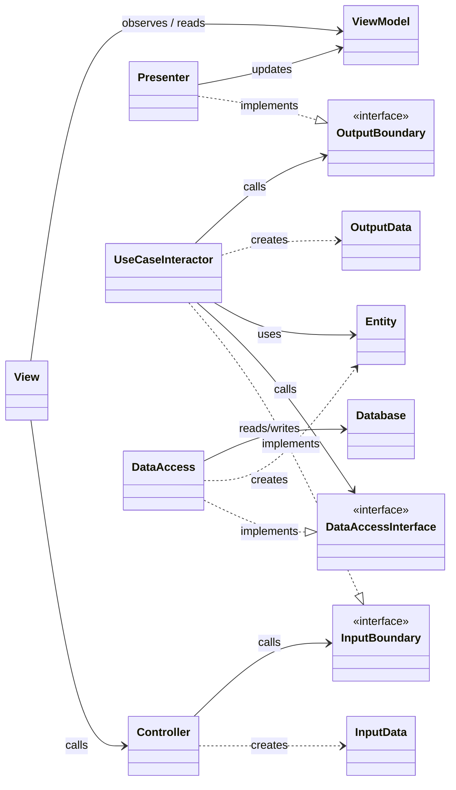

# CSC207 Software Design: Course Notes Reference (Ch. 8–13)

> **What this is:** a condensed reference compiled from the CSC207 (UofT, Fall 2026) course notes, chapters 8–13: Program Specification, Design Principles (SOLID), Layered Architectures, Clean Architecture, Design Patterns, and Refactoring. It is written so people and AI agents can look things up quickly.
> **Companion file:** `CSC207_Project_Reference.md` has the project requirements, milestones and grading rubric.
> **Conventions:**
> - Course content is paraphrased closely, and terminology and class names match the notes exactly.
> - **(derived)** marks interpretation or project application added during compilation. It is *not* from the notes.
> - The notes' diagrams were images. Here they are redrawn from the notes' own descriptions as text or Mermaid.
>
> **Compiled:** 2026-11-16

---

## 0. Core rules at a glance

1. **"Low coupling, high cohesion"** is the goal behind everything below.
2. **A specification says WHAT the program does, not HOW.** User stories and use cases leave out class names, method calls, database details and specific UI widgets.
3. **One user story → one focused user goal → one use case → one Use Case Interactor.** This is the course heuristic. Don't create an interactor for every click or screen transition; design around one coherent user goal.
4. **Dependency Rule:** source-code dependencies point **inward only**, in this order: Frameworks & Drivers → Interface Adapters → Use Cases → Entities. Inner layers never mention outer-layer classes.
5. **Use the DIP to let control flow outward while dependencies still point inward.** The **Input Boundary, Output Boundary and Data Access Interface** are interfaces that all belong to the **Use Case layer**.
6. **Entities depend on nothing** in the UI or database layers.
7. **The main component** (also called the "driver") is where concrete classes are created and wired together into the "CA engine".
8. **The interactor returns nothing to the Controller.** Results flow out through the Output Boundary to the Presenter, then the View Model, then the View (via the Observer pattern).
9. **Refactoring never changes behaviour.** The existing tests must keep passing.
10. **Patterns taught in this course:** Factory (Simple and Abstract), Builder, Strategy, Observer, Adapter, Façade.

---

## 1. Program Specification (Ch. 8)

**Pipeline:** written specification → noun–verb analysis → entities (UML class diagram) → scenario walk-throughs → user stories → use cases → Clean Architecture design.

### 1.1 Noun–verb analysis: specification → classes

1. Read the specification, then read it again (you notice different things each time).
2. **Underline nouns.** Each is a candidate class, or information some class must store.
3. **Circle verb phrases.** Each is a candidate **responsibility**, which will eventually become a method.
4. Decide **which class is responsible** for each verb phrase, and which class stores each piece of information.

This is a starting point, not a mechanical rule. Many nouns aren't classes: they are attribute values, synonyms or irrelevant. Some responsibilities never appear as verbs at all. **The refining is where the real design work happens.**

**Worked example (restaurant review system), with the design lessons it teaches:**

| Situation in spec | Design decision |
|---|---|
| price range, neighbourhood, username, email | Just **values** stored by another class, not classes |
| recommendation (Thumbs Up / Thumbs Down) | One of two fixed choices, so probably an **enum** |
| Owners and reviewers both log in with a username and may be emailed | **Abstract class** `User` (`username`, `email`, `logIn`); `Owner` and `Reviewer` extend it |
| Only some restaurants have a liquor licence (renewed yearly) | **Subclass** `LicensedRestaurant` owns the licence and `renewLicense` |
| Only some offer take-out, and one restaurant may be licensed *and* offer take-out | Java allows only one superclass, so make **interface** `Takeout` (`getAvgWaitTime`) |
| Does a `Review` know its `Restaurant`? Its author? Where do reviews live? | **No single right answer.** Discuss the pros and cons as a team; each choice makes some operations easy and others awkward |

The output is usually a **UML class diagram**. The classes that represent problem-domain data are the program's **entities**.

### 1.2 Scenario walk-throughs: checking a design

Manually "execute" a scenario against the design:

1. Find the class responsible for the first step.
2. Trace which other classes it collaborates with, and what it asks them to do.
3. If a step has no responsible class, or a class needs information it can't get, **adjust the design**.
4. Start over, and repeat until the design **stabilizes** (a full pass with no changes).

*Example:* walking through "Write a review" showed that nothing was responsible for storing reviews, since "store" never appeared as a verb. Fix: add `addReview` and a review collection to `Restaurant`. The technique comes from CRC-card modelling but works with UML diagrams too.

### 1.3 User stories

- A **user story** describes a feature **from the user's perspective**, focusing on the **value** it provides.
- Common (optional) format: **"As a [kind of user], I want to [accomplish a goal] so that [I receive some benefit]."**
  - *Example:* As a user, I want to be able to send friend requests so that I can connect with people I know.
  - *Example:* As a group administrator, I want to be able to hide posts that violate the code of conduct so that others can feel more comfortable participating.
- Stories are short on purpose. They start a discussion and aren't a complete specification. Teams may add **acceptance criteria**: observable conditions that must be true for the story to count as done.

**Choosing scope:**

| Scope | Example | Assessment |
|---|---|---|
| **Too broad (epic)** | As a bank customer, I want an online banking platform so that I can manage all of my accounts. | Contains many goals (view account, transfer money, pay a bill…) |
| **Appropriate** | As a bank customer, I want to view the transactions in my savings account so that I can review my spending. | One user goal that can become one use case |
| **Too narrow (task)** | Create a table component that displays transactions. | An implementation task: it doesn't say who benefits or why |

- **Course heuristic:** each story covers **one focused user goal**, is small enough for **one team member** to make meaningful progress on, and leads naturally to **one use case**.
- If a story contains several distinct goals, **split it**.
- If it only describes a class, algorithm, screen or other implementation detail, find the **larger user goal** behind it.
- *E-commerce example:* "Manage products" is an epic. View products, update shopping cart and update wish list are separate stories. "Lay out a screen" is a task.

### 1.4 Use cases

A **use case** describes how an **actor** and the **system** interact to accomplish a goal. It adds behavioural detail to a user story: what starts the interaction, what normally happens, what can go wrong, and what outcome the system guarantees.

**Lightweight use-case format (the course's recommended format):**

| Field | Meaning |
|---|---|
| **Name** | Active verb phrase stating the actor's goal ("Send a friend request") |
| **Primary actor** | The external role that starts the use case to achieve a goal. **The system itself is never an actor.** Other people or systems involved are *supporting actors*. |
| **Preconditions** | Facts already true when it begins. These are **assumptions, not steps**. |
| **Trigger** | The event that starts the use case |
| **Success outcome** | The observable system state once the goal is achieved (a fuller spec may also say what's guaranteed on failure) |
| **Main success scenario** | Numbered steps of the usual successful interaction between actor and system |
| **Extensions** | Alternative or failure paths, tied to the step where they occur (2a, 3a, …) |

**Writing rules:**
- Write steps as the **actor's intent** and the **system's observable response**.
- Include enough detail to remove important ambiguity.
- **Avoid** class names, method calls, database operations and unnecessary UI details. Write "the user asks to send a friend request", not "clicks the Send button". Those details are design decisions.

**Full example from the notes:**

> **Use Case: Send a Friend Request**
> **Primary actor:** User sending the request
> **Preconditions:** The user is logged in. The user is viewing another user's profile. The two users are not already friends and there is no pending request between them.
> **Trigger:** The user asks the system to send a friend request to the person whose profile is displayed.
> **Success outcome:** The request is recorded as pending and the other user is notified.
> **Main success scenario:**
> 1. The user asks to send a friend request.
> 2. The system checks that a request is currently allowed.
> 3. The system records the pending friend request.
> 4. The system shows the user that the request is pending.
> 5. The system notifies the other user of the request.
>
> **Extensions:**
> - **2a.** The other user no longer accepts friend requests from this user. (1) The system explains that the request cannot be sent. (2) No request is created; the use case ends.
> - **3a.** The system cannot record the request. (1) The system explains that the request was not sent and the user may try again. (2) The use case ends with no pending request.

**Keep goals separate.** Searching for a person or viewing their profile happens *before* this use case and could be a use case of its own. Accepting or declining the request is a different goal ("Respond to a Friend Request") with a **different primary actor**. Separate goals are easier to understand, assign, implement and test.

**Blank template (derived), ready to copy:**

```markdown
### Use Case: <Active verb phrase>
**Primary actor:** <external role>
**Preconditions:**
- <fact already true>
**Trigger:** <event that starts it>
**Success outcome:** <observable state after success>
**Main success scenario:**
1. <actor asks / does …>
2. The system <observable responsibility>
**Extensions:**
- **2a.** <condition>
  1. The system <response>.
  2. <state change or "the use case ends">.
```

**Self-review checklist (from the Ch. 8 exercise):**
- [ ] Does the use case pursue **one** user goal?
- [ ] Are preconditions stated as **facts** rather than hidden setup steps?
- [ ] Does each main-flow step describe an **actor action** or an **observable system responsibility**?
- [ ] Are alternative and failure paths kept **separate** from the success path?
- [ ] Does the success outcome make the use case **testable**?
- [ ] Have you avoided committing too early to UI widgets, classes, methods or database details?

### 1.5 From use case to design

A use case says what behaviour is required. It doesn't prescribe the UI or the classes. Next steps:
- Add **acceptance criteria or tests** for the success and extension paths.
- **Sketch the views** before and after important interactions, including error states.
- Identify the **entities** and **data access operations** involved.
- Design the **Clean Architecture classes** that realize the use case. The **interactor** implements the application-specific rules for the goal. The **controller, presenter, view model and view** connect those rules to the UI.

---

## 2. Design Principles: SOLID (Ch. 9)

**Background:**
- Coupling and cohesion were recognized as foundational concepts in the mid-1970s.
- Robert Martin consolidated five widely accepted principles into the acronym **SOLID** in the 2000s.
- All five help keep **coupling low and cohesion high**. CSC207 uses them to analyze design choices, and they come up often in internship interviews.

| | Principle | Definition (as given in the notes) | Violation smell *(derived)* | Typical fix |
|---|---|---|---|---|
| **S** | Single Responsibility (SRP) | A class should have only one reason to change | One class changes for UI reasons *and* database reasons *and* formatting reasons | Split the class by reason for change (by actor) |
| **O** | Open/Closed (OCP) | A class should be open for extension but closed for modification | Adding a feature means editing existing `if`/`switch` chains or shared classes | Extend through interfaces, inheritance or composition (plugin style) |
| **L** | Liskov Substitution (LSP) | Subclasses should be substitutable for their base classes | A subclass overrides a method to throw, or breaks the base class's expected behaviour | Redesign the hierarchy; specify and document the supertype well |
| **I** | Interface Segregation (ISP) | Programmers should not be forced to write or rely on interface methods they do not use | Implementers stub out irrelevant methods; clients depend on methods they never call | Split into smaller, focused interfaces |
| **D** | Dependency Inversion (DIP) | High-level modules should not depend on low-level modules. Both should depend on abstractions. | Core logic `new`s or directly references a concrete database, API or UI class | Put an interface between them; high-level code depends only on the interface |

### 2.1 SRP: one reason to change
- Often misstated as "each class should have one responsibility". That simplification misses the point.
- Robert Martin's version: *"Gather together the things that change for the same reasons. Separate those things that change for different reasons."*
- Changes come from **actors**: a user, a stakeholder, a group of people, or even an automated process. A module should answer to **one narrowly defined business function**.
- Martin says the SRP is essentially describing high cohesion and low coupling.
- **Example:** a `UserProfile` class that both displays user info and saves it to a database has two reasons to change. Split it into display logic and persistence logic.
- **Exercise answer (from the notes):** a `Report` class with `generate()`, `saveToFile(path)` and `email(address)` violates the SRP (content, file writing and emailing are three reasons to change). Fix: a `Report` that only produces text, plus a `ReportFileWriter` and a `ReportEmailer`. Adding a `ReportOutput` interface that both writers implement, with callers depending on it, also applies the DIP.

### 2.2 OCP: open for extension, closed for modification
- You should be able to add new functionality **without modifying existing code**.
- **Plugin systems** (IntelliJ plugins, game mods) are the canonical example. The plugin implements methods the main program calls; the main program's code is never edited. In Java, **interfaces** specify what plugins must implement, so the main program doesn't need to know the concrete type.
- **Why avoid modifying code:** Alice and Bob both rely on a shared class. Bob changes it for his feature, and Alice's feature breaks. Modifying shared code risks breaking dependents, obscures what the code was meant to do, and introduces subtle bugs.

### 2.3 LSP: subtypes must be substitutable
- **Formally:** if S is a subtype of T, objects of type S may replace objects of type T without altering any of the program's desired properties. (T is a class or an interface; S extends or implements it.)
- **Bird/Penguin:** if `Bird.fly()` exists and `Penguin` overrides it to throw, code expecting any `Bird` to fly breaks. Fix: `Bird` ← `FlyingBird` ← `Sparrow`, and `Penguin` extends `Bird` directly.
- **Square/Rectangle:** if `Square extends Rectangle`, then `r.setWidth(2); r.setHeight(5); r.area()` won't give 10 for a `Square`. A `Square` shouldn't have independent `setWidth` and `setHeight` at all. **A mathematical "is a" relationship doesn't automatically justify inheritance.**
- The supertype must be **well specified**, so writing well-documented interfaces is essential.

### 2.4 ISP: no forced dependence on unused methods
- **Implementer side:** an `Animal` interface with `eat`, `sleep` and `fly` forces `Dog` to implement `fly`. Split it into `Eater`, `Sleeper` and `Flyer`. (Java `default` methods are an alternative: `fly` could default to doing nothing.)
- **Client side:** if your class depends on `Service {m1, m2, m3}` but only uses `m1`, changes to `m2` or `m3` still force recompiling and retesting it. That's unnecessary coupling. Design small, focused interfaces exposing only what each client needs.

### 2.5 DIP: depend on abstractions
- A "module" here means a class, or a set of closely related classes (such as those in one `.java` file).
- **Low-level** means implementation details: volatile, likely to change, often external dependencies. **High-level** means the core logic, what really matters.
- **Before:** `HighLevel → LowLevel`. `HighLevel` is tightly coupled to `LowLevel`'s details.
- **After:** `HighLevel → «interface» Interface ← LowLevel (implements)`.
  - The `Interface` defines the contract (e.g., `f()`). `LowLevel` implements it, and `HighLevel` depends only on the interface.
  - The dependency arrow on `LowLevel` is now **inverted**: nothing points at `LowLevel`, so it can be swapped freely.
- **Caveat:** a poorly designed interface doesn't help, because now everything depends on it. **Interfaces must be stable.**
- **Managers/workers example:**
  - `Manager` takes `Worker`. Adding `SuperWorker` would mean rewriting `Manager` (a new field, a new setter, an `if` per type).
  - Fix: an `IWorker` interface. `Manager` depends only on `IWorker` and works with *any* implementation, including ones written later.

---

## 3. Layered Architectures (Ch. 10)

### 3.1 Policies and levels
- A program is a set of **policies**: rules governing how inputs become outputs (in CS terms, invariants, preconditions and postconditions).
- A policy's **level** is its **distance from input/output**.
  - **High-level policies** are far from I/O; they are the core logic. *Examples:* a book with another user's hold can't be checked out or renewed; a fancy bank account allows up to $1000 overdraft.
  - **Low-level policies** are close to I/O: UI interactions, file access, network communication, how data is stored in a database.
- **Goal:** keep high-level policies **independent** of low-level ones. The "can't renew with a hold" rule is the same whether the user clicks a "Renew" button or the data comes from a database. This improves testability, reduces coupling, and makes the system easier to reason about.

### 3.2 Event-driven programming
- User actions (clicks, keystrokes) are **events**. The program reacts through **event listener** methods, which receive an **event object** describing the interaction.
- A listener calls other methods, forming a **chain of method calls**, which makes a **network of objects**. At runtime, the call stack tracks the calls (with the listener at the bottom) and the heap holds the objects.
- Adding a new user interaction means writing a new event listener.

### 3.3 Why layers
Each layer has a specific role, such as UI, data storage or core logic. Benefits:
- Changes in one layer are less likely to affect others.
- Related code stays grouped together, which helps avoid **Git merge conflicts**.
- Changes touch fewer files, so there are fewer chances to introduce errors.
- Code within a layer follows consistent patterns (e.g., UI classes contain event listeners).

**Model / entities:**
- The **model** is how you represent the program's data, for example a `Book` class whose objects represent the current state. These objects are **entities**.
- Entities must have **no dependencies on the UI or database layers**: they can't mention any class defined in those layers.

**Architecture patterns** (roughly in the order they became popular):
1. MVC
2. MVP
3. MVVM
4. Ports and adapters
5. Onion
6. Hexagonal
7. **Clean Architecture** (the course focus)

All seven aim for low coupling and high cohesion, with ways to cross layers without adding coupling. They differ slightly in what "model" means and how events are handled.

**Common to all of them:**
- An **event listener** in the **UI layer** handles a user interaction.
- It calls the **controller/presenter/viewmodel** layer, which manipulates the problem-domain data.
- Somewhere, code saves and reads data from a database, file or network.

### 3.4 MVC: Model View Controller
1. The user interacts with the View, which creates an event.
2. Java calls a listener method in a View object.
3. The View immediately calls a Controller method to handle the event.
4. The Controller manipulates the Model.
5. The Model fetches any necessary data from the database.
6. The Model calls a View method to say there's been an update.
7. The Controller decides which screen to display.
8. The View calls getters on the Model and updates the UI.

**Problem:** circular dependencies and tight View↔Model coupling make it hard to test and maintain.

### 3.5 MVP: Model View Presenter
1. The user interacts with the View, which creates an event.
2. Java calls a listener method in a View object.
3. The View immediately calls a Presenter method to handle the event.
4. The Presenter manipulates the Model.
5. The Model fetches any necessary data from the database.
6. The Model calls a Presenter method to say there's been an update.
7. The Presenter calls View methods to update the UI.

The Presenter plays roughly the Controller's role, but **the View and Model don't depend on each other**.

### 3.6 Finer-grained architectures and Clean Architecture's four layers
Ports-and-adapters, onion, hexagonal and Clean Architecture are variations on one theme. A core **domain layer** (entities plus business logic, e.g. calculating GPA or checking permissions) is surrounded by layers that handle the user, databases, files and networks.

| # | CA layer | CA book term | Policy level | Contains |
|---|---|---|---|---|
| 1 | **Entities** | Enterprise Business Rules | Highest | Problem-domain data and logic (the Model) |
| 2 | **Use Cases** | Application Business Rules | Medium | Application-specific rules. Objects specific to a single user interaction, each with a method the Controller calls to handle as much of the interaction as possible |
| 3 | **Interface Adapters** | — | Lower | Converts data between the format the use cases and entities prefer and the format external layers prefer. Controller, Presenter, ViewModel |
| 4 | **Frameworks & Drivers** | — | Lowest | Code that talks to the user and to databases. View, database |

---

## 4. Clean Architecture (Ch. 11)

### 4.1 The Dependency Rule
**CA has one rule: all dependencies point inwards, from lower-level policies to higher-level policies.**

The rule is usually shown as **concentric rings**, from outside to inside: Frameworks & Drivers → Interface Adapters → Use Cases → **Entities** (the core). The original diagram is at https://blog.cleancoder.com/uncle-bob/images/2012-08-13-the-clean-architecture/CleanArchitecture.jpg

**How does information get back out without outward dependencies?** Through the **Dependency Inversion Principle**. The inner layer defines an interface, and the outer layer implements it. Control flows outward while the source-code dependency points inward.

### 4.2 The "CA engine": the typical-scenario class diagram
This is redrawn from the notes' description of the CA book's typical-scenario UML diagram. Wiring instances of these classes together is what the course calls the **"CA engine"**.



**Where the DIP is applied (the three inversions):**
- Controller → **Input Boundary** ← Interactor
- Interactor → **Output Boundary** ← Presenter. This lets results flow *outward* to the UI.
- Interactor → **Data Access Interface** ← Data Access. This lets the core use a database without depending on it.

### 4.3 Components by layer

| Layer | Component | Kind | Responsibility |
|---|---|---|---|
| **Frameworks & Drivers** | `View` | class | Displays information and reacts to user interaction. Asks a Controller to do what the user wants. Displays data stored in its ViewModel and is **alerted when the ViewModel changes**. |
| | `Data Access` | class | Reads and writes persistent data (file or database outside the program). **Implements the Data Access Interface** from the Use Case layer. Creates temporary Entities for the Use Case to work with. |
| **Interface Adapters** | `Controller` | class | Converts raw user data into something useful (string → `Date`, float → currency), builds an **Input Data** object, and calls the Input Boundary method to start the use case. |
| | `Presenter` | class | **Implements the Output Boundary.** Receives Output Data from the interactor, converts it to raw strings and numbers for display, and **updates the ViewModel**. |
| | `View Model` | class | Storage for what the View needs to display (e.g., the logged-in user's name). The View gets everything it needs from here. |
| **Use Cases** | `Use Case Interactor` | class | **Implements the Input Boundary.** Takes Input Data, executes the use case, looks up data via the Data Access Interface, manipulates Entities, may save new data, then creates **Output Data** and passes it to the Presenter through the Output Boundary. |
| | `Input Data` | class | Created by the Controller with the user's input, in the format most convenient for the interactor. |
| | `Output Data` | class | The result of the use case. Created by the interactor and sent through the Output Boundary. |
| | `Input Boundary` | **interface** | Implemented by the Interactor; **called by the Controller**. |
| | `Output Boundary` | **interface** | Implemented by the Presenter; **called by the Interactor**. |
| | `Data Access Interface` | **interface** | Implemented by Data Access. Specifies how the interactor needs to access data. |
| **Entities** | `Entity` | class | The program's "Model", i.e. temporary information storage. Building blocks (e.g., `Car`, `Renter`). **Enforces enterprise business rules.** *Example:* if U of T doesn't allow enrolling in more than 7 courses in a semester, the `Student` entity enforces that rule (U of T is the "enterprise" behind ACORN). |

> **Key point from the notes:** the three interfaces belong to the Use Case layer and **fully specify the core logic** of the system. *Everything else is just a detail.*

The Use Case layer covers **everything the user can do**: in a calendar app, creating and searching events; in a messaging app, creating and storing messages and retrieving conversations.

### 4.4 Flow of control: one user interaction, step by step

| Step | From → To | What happens |
|---|---|---|
| 1 | **View → Controller** | User interacts with the View; the event's input is passed to the Controller. |
| 2 | **Controller → Input Boundary** (Interactor) | Controller bundles the input into **Input Data** and calls the Input Boundary method that takes it. |
| 3 | **Interactor → Data Access Interface** (Data Access) | Interactor reads data it needs, e.g. gets an Entity using info from the Input Data. |
| 4 | **Data Access → Database** | Data Access does whatever it must to read from the real storage. |
| 5 | **Interactor → Entities** | Interactor uses Entity methods to do its work. *Steps 3–5 can repeat or reorder* (e.g., saving afterwards), depending on the use case. |
| 6 | **Interactor → Output Boundary** (Presenter) | Interactor creates **Output Data** and passes it through the Output Boundary. |
| 7 | **Presenter → View Model** | Presenter updates the ViewModel. The View is alerted and updates itself, and the user sees the result. |

> Nothing is ever **returned** to the Controller. *(derived)* So the Input Boundary method's return type is **`void`**.

### 4.5 The main component (assembling the CA engine)
- The **main component** creates instances of everything and **connects them**. This is where you choose which implementation of each interface gets plugged in.
- References follow the flow. For step 1 the View must hold a Controller; for step 2 the Controller must hold a reference of type Input Boundary; and so on.
- **The payoff:** you can create **different main components ("drivers")** for different purposes. For example, a test driver can plug in a Data Access implementation built for edge cases instead of the production one.

### 4.6 Allowed dependencies per layer *(derived from the Dependency Rule and §4.3)*

| Class in… | May reference | Must NOT reference |
|---|---|---|
| **Entities** | Other entities, the Java standard library | Anything in use case, adapter, view or data access code; Swing; database or API libraries |
| **Use Cases** (interactor, I/O data, boundaries, DAI) | Entities, same-layer classes | Controller, Presenter, ViewModel, View, concrete Data Access, Swing, HTTP/JSON/file libraries |
| **Interface Adapters** (controller, presenter, view model) | Use-case boundaries and I/O data, entities only if unavoidable | Swing View classes, concrete Data Access |
| **Frameworks & Drivers** (view, data access, API clients) | Interface adapters (View), use-case interfaces (Data Access implements DAI), entities | — (outermost layer) |
| **Main / app builder** | Everything (it does the wiring) | — |

**Common violations to check for in code review *(derived)*:**
- [ ] Interactor imports a Swing class, `JOptionPane`, a concrete DAO, an HTTP client or a JSON library.
- [ ] Interactor `return`s a result to the Controller instead of calling the Output Boundary.
- [ ] Entity has a `save()` method or knows about files, JSON or an API.
- [ ] Controller calls the Presenter or ViewModel directly, skipping the use case.
- [ ] View calls the interactor or DAO directly, or contains business rules.
- [ ] Data Access Interface is declared in the `data_access` package instead of the use-case package.
- [ ] Presenter is handed Entities instead of Output Data.

### 4.7 Illustrative skeleton for one use case *(derived: names are examples only)*

```java
// ---- Use Case layer ----
public interface SendRequestInputBoundary {            // implemented by the interactor
    void execute(SendRequestInputData inputData);      // void: nothing returns to the Controller
}
public interface SendRequestOutputBoundary {           // implemented by the presenter
    void prepareSuccessView(SendRequestOutputData outputData);
    void prepareFailView(String errorMessage);
}
public interface SendRequestDataAccessInterface {      // implemented by data access (ISP: only what this use case needs)
    boolean hasPendingRequest(String fromUser, String toUser);
    void save(FriendRequest request);
}
public class SendRequestInteractor implements SendRequestInputBoundary {
    private final SendRequestDataAccessInterface dataAccess;
    private final SendRequestOutputBoundary presenter;

    public SendRequestInteractor(SendRequestDataAccessInterface dataAccess,
                                 SendRequestOutputBoundary presenter) {
        this.dataAccess = dataAccess;
        this.presenter = presenter;
    }

    @Override
    public void execute(SendRequestInputData in) {
        if (dataAccess.hasPendingRequest(in.getFromUser(), in.getToUser())) {
            presenter.prepareFailView("A request is already pending.");   // extension path
            return;
        }
        FriendRequest request = new FriendRequest(in.getFromUser(), in.getToUser()); // Entity
        dataAccess.save(request);
        presenter.prepareSuccessView(new SendRequestOutputData(in.getToUser()));     // success path
    }
}

// ---- Main component: wiring the CA engine ----
SendRequestDataAccessInterface dao = new FileFriendRequestDataAccess("requests.json"); // swap in an in-memory DAO for tests
SendRequestViewModel viewModel = new SendRequestViewModel();
SendRequestOutputBoundary presenter = new SendRequestPresenter(viewModel);
SendRequestInputBoundary interactor = new SendRequestInteractor(dao, presenter);
SendRequestController controller = new SendRequestController(interactor);
SendRequestView view = new SendRequestView(controller, viewModel);  // View registers as a listener on the ViewModel
```

**Testing an interactor *(derived)*:** construct it with an **in-memory DAO** and a **test presenter** that records what it receives. Call `execute(...)`, then assert on the recorded Output Data or error message and on the DAO's state. No Swing, files or network are needed. This is how to reach 100% line coverage of the Use Case layer.

### 4.8 Review / thought questions with answers *(derived)*
- **Is an event listener a high- or low-level policy?** Low-level: it's right at the input.
- **What level of policy do entities represent?** The highest (enterprise business rules).
- **Why shouldn't a high-level policy depend on a low-level one?** Low-level details are volatile, so changing a UI widget, database or API would force changes to core logic. It also makes core logic hard to test in isolation.
- **Return type of the Input Boundary method?** `void`. Results go out through the Output Boundary.
- **Which SOLID principles does CA reflect?** *(Useful presentation talking points.)*
  - **SRP:** Controller, Interactor, Presenter, ViewModel, View and Data Access each change for a different reason or actor.
  - **OCP:** new use cases are added as new sets of classes; a new storage backend is a new Data Access class, with no interactor edits.
  - **LSP:** any Data Access Interface implementation (file, API, in-memory test) can be substituted without the interactor noticing.
  - **ISP:** each use case gets its own narrow Data Access Interface and boundaries, containing only the methods it needs.
  - **DIP:** the interactor depends on the Output Boundary and Data Access Interface abstractions, never on the Presenter or concrete DAO.

---

## 5. Design Patterns (Ch. 12)

- A **design pattern** describes a popular solution to a commonly experienced programming problem.
- An **anti-pattern** is a less convenient solution used instead. You fix it by **refactoring toward the pattern**.
- Patterns describe **structure, not details**. They are language-independent and a shared vocabulary for design ideas, so UML is the natural way to show them.
- **Principles vs. patterns:** principles (SOLID) are like **axioms**, and patterns are like **theorems** derived from them. Following the principles tends to lead to the patterns anyway; the value of knowing the patterns is a common language.
- **History:** published by the "Gang of Four" in 1995. The book has 23 patterns: 11 behavioural, 5 creational and 7 structural.
- CSC207 covers **six**, two per category. (CSC301 and CSC302 cover more.)

### 5.1 Creational patterns: *who is responsible for creating each object?*
These patterns decide where `new MyClass(...)` calls go and how the created objects get linked, avoiding tight coupling and inflexible instantiation.

#### Factory
- **Problem:** you need objects that are all subclasses or implementations of one abstraction, but you don't want code to depend on the exact class names or how they're built.
- **Solution:** a factory object or method decides which class to create and returns a ready-to-use instance.
- **Variants:**
  1. **Simple Factory:** a (usually static) method that creates objects based on input parameters.
  2. **Factory Method:** uses *inheritance*, so subclasses decide which class to instantiate. (Its Client and Factory roles are combined. It's mentioned in the notes but not the focus.)
  3. **Abstract Factory:** uses *composition* to delegate creation to another object, which creates a family of related objects.

```java
// Simple Factory
public class ShapeFactory {
    public Shape getShape(String shapeType) {
        switch (shapeType) {
            case "Rectangle": return new Rectangle();
            case "Circle":    return new Circle();
            case "Square":    return new Square();
            default: throw new IllegalArgumentException("Wrong shape type: " + shapeType);
        }
    }
}

// Abstract Factory: choose the factory first; there are no conditionals afterwards
public abstract class ShapeFactory { public abstract Shape getShape(); }
public class CircleFactory extends ShapeFactory { public Shape getShape() { return new Circle(); } }
// RectangleFactory, SquareFactory are analogous
ShapeFactory factory = new CircleFactory();   // could be chosen based on user input
Shape shape = factory.getShape();
```

| Aspect | Simple Factory | Abstract Factory |
|---|---|---|
| Creation logic | All in one class | Spread across subclasses |
| Adding new types | Add a new `if`/`case` (**modifies** existing code) | Add a new factory subclass (**extends** existing code, so it follows the OCP) |
| Client usage | Client specifies type via a String parameter | Client chooses the factory |

#### Builder
- **Problem:** creating a complex object with many parts or options makes code messy and hard to read.
- **Solution:** a step-by-step **builder** assembles the object piece by piece, then returns the finished product.
- **The pattern:** create the builder, call step methods (each returns the builder, so calls chain), then call a final method to get the product.
- **Examples from the course:**
  - `new StringBuilder().append(...).append(...).toString()`
  - OkHttp: `new Request.Builder().url(...).addHeader(TOKEN, getAPIToken()).addHeader(CONTENT_TYPE, APPLICATION_JSON).build()`
- IntelliJ has a **Replace Constructor with Builder** refactoring.

### 5.2 Behavioural patterns: *how are responsibilities distributed, and how do objects communicate?*

#### Strategy
- **Problem:** you have several algorithms for the same task and want to switch between them easily.
- **Solution:** put each algorithm in its own class behind a common interface, so the algorithm can change without changing the code that uses it.
- **Roles:** a **Context** holds a **Strategy** interface; **Concrete Strategies** implement it. The strategy is set via the constructor or a setter, and can be swapped at runtime.
- **Example:** `Map` (the Context) holds a `DirectionGenerator` (the Strategy). `DrivingDirections` and `TransitDirections` are the Concrete Strategies.

```java
public class Map {
    private DirectionGenerator dg;
    public Map(DirectionGenerator dg) { this.dg = dg; }
    public String getDirections() { return dg.getDirections(); }
}
```

#### Observer
- **Problem:** several parts of the program must react when an object changes, without being tightly coupled to it.
- **Solution:** a **one-to-many** relationship. When the **Observable** changes, it notifies all its **Observers**, and it knows nothing specific about them.
- **Swing example:** a `JButton` (event) and its attached `ActionListener.actionPerformed` (reaction).
- **In CA:** each **View observes its ViewModel**. The ViewModel is the Observable; the View is the Observer.
- **Java mechanism:** the Observable uses `java.beans.PropertyChangeSupport`, which manages a list of `PropertyChangeListener`s. Calling `firePropertyChange(...)` invokes each listener's `propertyChange(evt)`.

```java
public class ViewModel<T> {
    private final PropertyChangeSupport support = new PropertyChangeSupport(this);
    private T state;
    public void addPropertyChangeListener(PropertyChangeListener l) { support.addPropertyChangeListener(l); }
    public void firePropertyChanged() { support.firePropertyChange("state", null, this.state); } // called by the Presenter
}

public class LoginView extends JPanel implements ActionListener, PropertyChangeListener {
    public void propertyChange(PropertyChangeEvent evt) {
        final LoginState state = (LoginState) evt.getNewValue();
        setFields(state);   // update the UI from the new state
    }
}
```

### 5.3 Structural patterns: *how are classes and objects combined and connected?*

#### Façade
- **Problem:** a subsystem exposes many classes and operations, forcing clients to deal with unnecessary complexity.
- **Solution:** a simple client-facing class (the **façade**) offers methods for common tasks and hides the subsystem's details, **delegating** each call in one line.
- **Example:** `EmployeeFacade` holds a `PayCalculator`, an `HourReporter` and an `EmployeeSaver`. Its `calculatePay()` just returns `payCalculator.calculatePay()`. This also shows the SRP applied, with the façade hiding the split.
- A creational pattern such as Builder can help assemble the façade's internal parts.

#### Adapter
- **Problem:** two components can't work together because their interfaces don't match. This often happens when reusing a class designed for a different context.
- **Solution:** an **adapter** exposes the interface the client expects and forwards calls to the existing ("legacy") class, converting inputs and outputs. It's like a USB-C-to-HDMI adapter: neither side changes.
- **Two variants:**
  - **Delegation:** the adapter *holds* the legacy object. *Example:* `MovieTicket` has a `Ticket` field and a `seatNumber`; `sellTicket()` calls `ticket.sell()` and then prints the seat.
  - **Inheritance:** the adapter *extends* the legacy class. *Example:* `MovieTicket extends Ticket`; `sellTicket()` calls `super.sell()` and then prints the seat.

### 5.4 Pattern summary

| Category | Focus | Key question | Patterns covered |
|---|---|---|---|
| **Creational** | Object creation | Who is responsible for creating each object? | Factory, Builder |
| **Behavioural** | Interaction and communication | How are responsibilities distributed, and how do objects communicate? | Strategy, Observer |
| **Structural** | Organization and connection | How can objects be connected to work together? | Adapter, Façade |

### 5.5 Patterns and the project rubric *(derived)*
- The **Login example** shown in the notes already uses **Observer** (View ↔ ViewModel via `PropertyChangeSupport`), and the course's API code uses **Builder** (OkHttp `Request.Builder`). These probably count as "already in the starter code".
- **3/5 and 4/5 on Overall Design** need *another* pattern that fits the project, beyond the starter code, implemented and clearly described. Candidates: **Strategy** (swappable sorting, filtering, scoring or recommendation algorithms), **Factory** (creating entity variants), **Adapter** (wrapping an external API's response format behind your Data Access Interface), **Façade** (one entry point over several API or data classes).
- **5/5** needs significant use of a pattern **not presented in class**. Patterns the course didn't present include **Command** (undo/redo), **Decorator**, **Template Method**, **State**, **Composite**, **Iterator**, **Memento** and **Proxy** (e.g., caching API responses).
- Confirm with the TA what counts as "starter code".

---

## 6. Refactoring Techniques (Ch. 13)

**Refactoring:** a series of changes that **improve design without changing behaviour**. Reasons: easier to understand, navigate and debug; easier to test automatically; easier to add features. It covers both style (naming, indentation, braces) and structure (adding parameters, moving methods, regrouping statements).

> **Rule: when refactoring, the code must always pass the existing tests.** Re-run the tests after each step.

| Technique | What it does | When to use it | IntelliJ support |
|---|---|---|---|
| **Extract Method** | Move a subtask into a well-named helper method | A long method with several logical steps. Make the helper `private`; make it `static` if it only uses its parameters (and static members). Name it with a **verb phrase**. | Refactor → Extract Method (**Ctrl+Alt+M / ⌥⌘M**) |
| **Change Method Declaration** | Change a method's signature, e.g. its parameters | The API needs different inputs. Update all callers and the method body. | **Change Signature** |
| **Encapsulate Fields** | Make fields `private`, add getters/setters as needed, update direct accesses | Public or loose fields (a common Python habit). SonarQube flags public fields (rule RSPEC-1104). | Refactor → **Encapsulate Fields…** |
| **Split Loop** | Split one loop that does several independent computations into several loops | One loop with two accumulators. Splitting enables Extract Method. | Not built in: copy, paste and delete |
| **Slide Statements** | Move lines so related code sits together | E.g., move each accumulator declaration next to its loop before extracting | Move-statement shortcuts |
| **Replace Constructor with Builder** | Introduce a builder that constructs the object step by step | Constructors with many or optional parameters | Built in |
| **Replace Constructor with Factory Method** | A static method returns instances instead of callers using `new` | Ambiguous constructors, e.g. `Temperature.fromCelsius(...)` and `fromFahrenheit(...)` instead of `new Temperature(double)`. Hides where instances come from. (See *Effective Java*, static factory methods.) | Built in |

**Typical sequence:** **Split Loop → Slide Statements → Extract Method**. Then replace **magic numbers with named constants**, keeping the tests green throughout.

**Further reading from the notes:**
- Martin Fowler, *Refactoring* (2nd ed.). Free chapter: https://www.thoughtworks.com/content/dam/thoughtworks/documents/books/bk_Refactoring2-free-chapter_en.pdf
- IntelliJ refactoring tutorial: https://www.jetbrains.com/help/idea/tutorial-introduction-to-refactoring.html
- Practice kata: https://github.com/emilybache/Theatrical-Players-Refactoring-Kata

---

## 7. Applying this to the course project *(derived)*

**Which section to use for each rubric criterion** (rubric in `CSC207_Project_Reference.md`):

| Rubric criterion | Use |
|---|---|
| Specification (10) | §1.3 user stories (right scope) and §1.4 use cases (lightweight format; *what*, not *how*) |
| Project Scope (5) | §1.3: one significant, **distinct** story per member, each leading to one use case |
| Clean Architecture (10) | §4: the Mermaid diagram (§4.2) for slides, the dependency table (§4.6), and the violations checklist |
| Overall Design (10) | §2 SOLID (discuss ≥2 richly, using §4.8 talking points) and §5 patterns (beyond starter code; one not presented in class for 5/5) |
| Code Quality (10) | §6 refactoring, Checkstyle, PR reviews |
| Tests (M3/M4) | §4.7: test interactors with in-memory DAOs and test presenters |

**Per-use-case checklist** (one set per team member's use case):
- [ ] User story ("As a…, I want…, so that…") and a use case in the lightweight format
- [ ] Entity changes, if any (no UI or database imports)
- [ ] `XInputData`, `XOutputData`, `XInputBoundary`, `XOutputBoundary`, `XDataAccessInterface`, `XInteractor`
- [ ] `XController`, `XPresenter`, `XViewModel` (plus a state class if used)
- [ ] `XView` (Swing; observes the ViewModel)
- [ ] Data Access implementation (file, database or API) implementing the use case's DAI
- [ ] Wired in the main component / app builder
- [ ] Interactor unit tests covering the success path and every extension path

---

## 8. Glossary

| Term | Meaning |
|---|---|
| **Actor** (SRP sense) | A user, stakeholder, group, or automated process that causes changes to a module |
| **Actor** (use-case sense) | The external role that starts a use case. The system is never an actor. |
| **Acceptance criteria** | Observable conditions that must hold for a story to be considered done |
| **Anti-pattern** | A less convenient solution used where a design pattern would fit better |
| **CA engine** | The connected set of CA objects (View, Controller, Interactor, Presenter, ViewModel, DAO…) built by the main component |
| **Cohesion / coupling** | How related a module's contents are / how dependent modules are on each other. Aim for high cohesion and low coupling. |
| **Data Access Interface** | Use-case-layer interface describing the data operations an interactor needs. Implemented by a Data Access class. |
| **Dependency Rule** | All source-code dependencies point inward, toward higher-level policies |
| **Entity** | A class representing problem-domain data and enterprise business rules |
| **Epic** | A story covering many related goals; too broad for one use case |
| **Event listener** | A UI-layer method called when a user event occurs; receives an event object |
| **Input / Output Boundary** | Use-case-layer interfaces: Controller → Interactor, and Interactor → Presenter |
| **Main component / driver** | Code that instantiates and wires the system; different drivers can plug in different implementations (e.g., for testing) |
| **Policy** | A rule for transforming inputs to outputs. Its level is its distance from I/O. |
| **Refactoring** | Improving design without changing behaviour; the tests stay green |
| **Scenario walk-through** | Manually executing a scenario against a design to find missing responsibilities |
| **Use case** | How an actor and the system interact to achieve one goal: preconditions, trigger, main scenario, extensions |
| **User story** | A short description of a feature from a user's perspective, focused on the value it provides |
| **View Model** | Interface-adapter class storing what a View displays; observed by the View |
